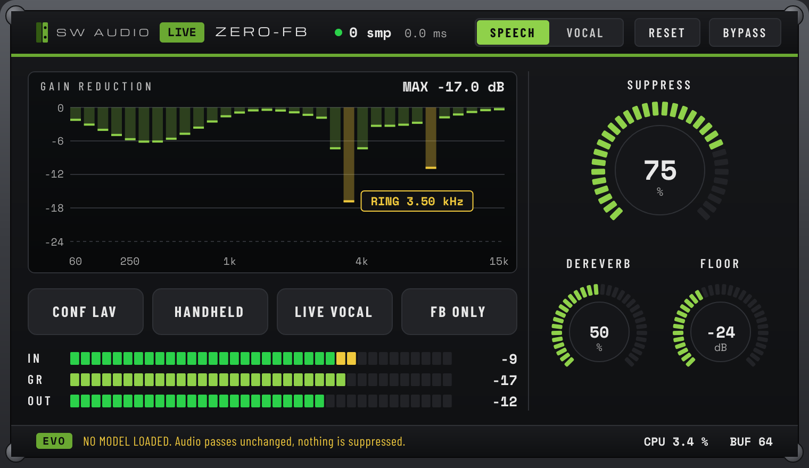

# ZERO-FB

**Zero-latency feedback, reverb and noise suppressor plug-in (VST3 / AU).**
A small recurrent network watches 32 ERB bands and steers a serial minimum-phase EQ. The audio path has no framing, no look-ahead and reports 0 samples of latency.

> **Status: in development toward v0.1.0.** The DSP core, the inference engine and the plug-in (VST3 / AU) with its UI are built and tested. There is no trained model yet: a plug-in built from this repository passes audio unchanged and says so on screen, so there is nothing to install today.



## Progress

| Step | Scope | State |
| :--- | :--- | :--- |
| 1 | DSP core, reference implementation, golden tests | Done |
| 2 | SIMD inference engine, closed-loop benchmark | Done (CPU target not yet measured on Apple M4) |
| 3 | Training data, model training, embedded weights | In progress |
| 4 | Plug-in UI, VST3 / AU builds, pluginval, packaging | UI and builds done. Not yet checked: real audio hardware, real DAWs, signing and packaging |

## What is here now

- `plugin/Source/dsp/` - the real-time pipeline as a header-only C++17 library with no JUCE dependency: 32-band sidechain analysis (AVX2 / NEON / scalar), 6-channel features, the hysteresis state machine, gain-coupling correction, the serial Cytomic SVF EQ, fail-safe guard, soft limiter and bit-perfect bypass.
- `plugin/Source/nn/` - the inference engine (Conv1d + 2-layer GRU, 167,888 parameters) on AVX2 / NEON / scalar kernels, and the `.swmodel` weight container.
- `training/erb_dsp.py`, `training/nn_reference.py` - independent NumPy references of the same math. `training/model.py` is the PyTorch definition used for training.
- `plugin/tests/` - `ZeroLatencyTest`, `GoldenParityTest`, `EngineBench` (CPU load), `ClosedLoopBench` (simulated acoustic feedback loop) and `PluginSoakTest` (plug-in wrapper checks and a one hour run), run on Linux, macOS and Windows by CI together with pluginval and auval.
- `plugin/Source/PluginProcessor.*`, `PluginEditor.*`, `ui/` - the JUCE plug-in: parameters, presets, state, and the 760 x 440 editor.
- `plugin/tools/UiSnapshot.cpp` - renders the editor to a PNG without a host.
- `docs/SPEC.md` - the single source of truth for every formula, state machine and acceptance test (Japanese).

The tests use fixed pseudo-random weights. They are not a trained model, so the benchmark figures say nothing yet about how well feedback is suppressed.

## Build and test

Requirements: CMake 3.22+, a C++17 compiler, Python 3 with NumPy (used to generate the golden fixtures at build time).

```sh
cmake -S . -B build -DCMAKE_BUILD_TYPE=Release
cmake --build build --config Release
ctest --test-dir build -C Release --output-on-failure
```

To build the plug-in as well, add `-DZEROFB_BUILD_PLUGIN=ON`. CMake then downloads JUCE 9.0.6. On Linux the usual JUCE packages are needed (X11, FreeType, Fontconfig, ALSA development files).

```sh
cmake -S . -B build -DCMAKE_BUILD_TYPE=Release -DZEROFB_BUILD_PLUGIN=ON
cmake --build build --config Release --target ZeroFb_All
```

Trained weights are not part of this repository. Without `plugin/Source/nn/EmbeddedWeights.h` the plug-in shows `NO MODEL LOADED` and does not suppress anything.

## Documents

- [docs/SPEC.md](docs/SPEC.md) - specification (v1.7). The document number is separate from the software version.
- [docs/SIMD.md](docs/SIMD.md) - SIMD implementation notes.
- [docs/ui_master.svg](docs/ui_master.svg) - UI design master.

## License

[GNU Affero General Public License v3.0](LICENSE).

Third-party components:

- [JUCE](https://github.com/juce-framework/JUCE) 9.0.6, used under AGPLv3. Downloaded at build time, not included here.
- Fonts in `plugin/Assets/Fonts/`: Michroma, Barlow Condensed and Space Mono, each under the SIL Open Font License 1.1 (see the `OFL-*.txt` files next to them).
